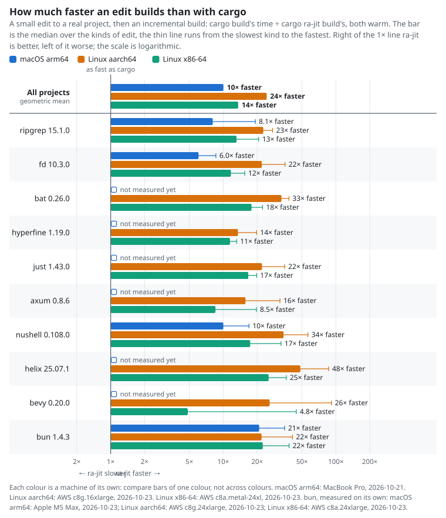
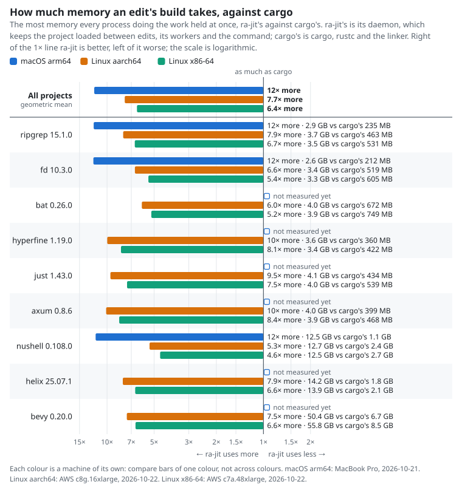
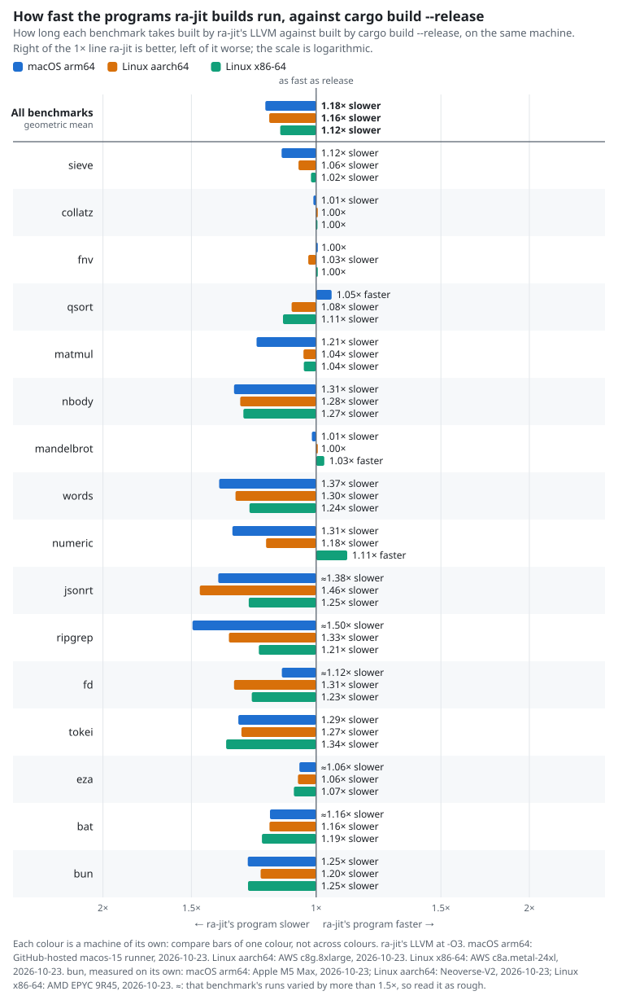

<h1 align="center">
  <picture>
    <source media="(prefers-color-scheme: dark)" srcset="docs/brand/ix-mark-on-dark.svg">
    
  </picture>
  ra-jit
</h1>

Edit Rust. See it change in milliseconds, in the program that is already running.

```
nix run github:indexable-inc/ra-jit
```

That opens a Game of Life window you can edit while it runs (live on macOS Apple silicon).


<p align="center">
  <a href="https://ra-jit.ix.dev/updates?src=readme">
    <picture>
      <source media="(prefers-color-scheme: dark)" srcset="docs/brand/signup-on-dark.svg">
      
    </picture>
  </a>
</p>

<p align="center">For release news: Watch → Custom → Releases on GitHub.</p>

## What you get

- **Live edits.** Save a file and the running program has the new code about a millisecond
  later. Its state stays. ([docs/live.md](docs/live.md))
- **Fast builds.** After the first build, an edit rebuilds only the functions you changed.
  No `rustc`, no waiting.
- **Same cargo.** `cargo ra-jit build|run|test|check` in any project.

## How fast

Live edit to running code, Game of Life demo (median of 20 edits, one 96-core Linux machine):

| Edit | incremental `cargo build` | ra-jit live | |
|---|---:|---:|---:|
| One function | 169 ms | 7 ms | **24x** |
| One function, 300 new functions added | 282 ms | 60 ms | 4.7x |

<!-- bench:start -->
<picture><source media="(prefers-color-scheme: dark)" srcset="docs/benchmarks/charts/edits-dark.svg"></picture>

Edit, then build, on real projects at pinned commits. Each cell is incremental `cargo build` → `cargo ra-jit build`, both warm, same linker, median of 5 edits. Linux x86-64, AWS c7i.16xlarge (dev-aws-7), pinned to 16 cores with taskset (Intel(R) Xeon(R) Platinum 8488C, 16 of its 64 cores, 124 GiB), ra-jit [`2b2f2dcd5b`](https://github.com/indexable-inc/ra-jit/commit/2b2f2dcd5bc4d7132fe62bf36669a34c657dafe7) on 2026-10-20.

| Project | Edit a function | Edit a widely used function | Change a signature | Nothing changed |
|---|---:|---:|---:|---:|
| ripgrep 15.1.0 | 655 ms → **104 ms** (6.3x) | 1.00 s → **62 ms** (16x) | 809 ms → **90 ms** (9.0x) | 30 ms → **33 ms** (0.9x) |
| fd 10.3.0 | 649 ms → **115 ms** (5.6x) | 600 ms → **103 ms** (5.8x) | 652 ms → **129 ms** (5.1x) | 43 ms → **35 ms** (1.2x) |
| bat 0.26.0 | 650 ms → **69 ms** (9.4x) | 936 ms → **58 ms** (16x) | 900 ms → **64 ms** (14x) | 81 ms → **32 ms** (2.5x) |
| hyperfine 1.19.0 | 528 ms → **117 ms** (4.5x) | 569 ms → **117 ms** (4.9x) | 583 ms → **162 ms** (3.6x) | 56 ms → **32 ms** (1.8x) |
| just 1.43.0 | 899 ms → **58 ms** (16x) | 926 ms → **58 ms** (16x) | 900 ms → **93 ms** (9.7x) | 54 ms → **30 ms** (1.8x) |
| axum 0.8.6 | 559 ms → **69 ms** (8.1x) | 1.11 s → **63 ms** (18x) |  | 102 ms → **34 ms** (3.0x) |
| nushell 0.108.0 | 1.62 s → **279 ms** (5.8x) | 5.78 s → **271 ms** (21x) | 5.82 s → **336 ms** (17x) | 240 ms → **38 ms** (6.3x) |
| helix 25.07.1 | 2.80 s → **231 ms** (12x) | 4.16 s → **86 ms** (48x) | 3.56 s → **354 ms** (10x) | 114 ms → **34 ms** (3.4x) |
| bevy 0.20.0 |  |  |  | 264 ms → **41 ms** (6.4x) |

- bevy 0.20.0: only the steps shown are measured, then the build failed: examples/showcase/breakout.rs:67:18: no method `chain` on type `(fn apply_velocity(Query<'_, '_, (&mut Transform, &Velocity), ()>, Res<'_,` …

Measured by hand with `harness/bench.py`; the `bench-readme` workflow re-runs it on the dedicated benchmark machine. The ra-jit measured is `cargo build --release`; the binaries a release ships are the `dist` profile with PGO, which start and edit faster ([how](https://github.com/indexable-inc/ra-jit/blob/main/docs/reports/RELEASE-BUILD.md)). Cold builds, the spread of every number, the LLVM tier and how fast the built programs run: [docs/benchmarks.md](docs/benchmarks.md) ([raw JSON](docs/benchmarks/linux-x86_64.json)).
<!-- bench:end -->

<!-- benchmem:start -->
<picture><source media="(prefers-color-scheme: dark)" srcset="docs/benchmarks/charts/memory-dark.svg"></picture>

Memory and disk, Cranelift. Peak: the most every process doing the work held at once, cargo → ra-jit. For ra-jit that is the daemon, its workers and what they run, and `cargo ra-jit build` with any cargo it ran; for plain cargo, cargo itself, rustc, build scripts and the linker. On disk: cargo's target directory → ra-jit's target directory, store and home. macOS arm64, MacBook Pro (Mac17,6), macOS 27.0.1, with other work running (Apple M5 Max, 18 cores, 128 GiB), ra-jit [`84760c3f51`](https://github.com/indexable-inc/ra-jit/commit/84760c3f517a76f6e8a3aa41ccd81fc3f26b87c7) on 2026-10-21, load average 48.0 when it started; how it is measured: [docs/benchmarks.md](docs/benchmarks.md#memory-and-disk).

| Project | Edit a function, peak | Daemon between edits | Cold until ready, peak | On disk |
|---|---:|---:|---:|---:|
| ripgrep 15.1.0 | 235 MB → **2.9 GB** | 2.2 GB ready, 2.8 GB after 39 builds | 541 MB → **2.4 GB** | 416 MB → 598 MB |
| fd 10.3.0 | 212 MB → **2.6 GB** | 1.8 GB ready, 2.6 GB after 33 builds | 897 MB → **1.9 GB** | 355 MB → 460 MB |
| nushell 0.108.0 | 1.1 GB → **12.5 GB** | 11.5 GB ready, 12.5 GB after 39 builds | 2.4 GB → **16.1 GB** | 5.3 GB → 6.9 GB |
<!-- benchmem:end -->

<!-- runbench:start -->
<picture><source media="(prefers-color-scheme: dark)" srcset="docs/benchmarks/charts/runtime-dark.svg"></picture>

How fast the programs run, built whole by ra-jit with LLVM (every crate of the program compiled by ra-jit, with its own `main`), each time ÷ the time of `cargo build --release`. Lower is faster; 1.00x is as fast as release. Every program's exit status and output were the same as the release build's; a run in which any differed is never published. Linux x86-64: AWS c6i.16xlarge (Intel Xeon Platinum 8375C, 64 vCPUs, 123 GiB), NixOS 26.05, Linux 6.18, rustc 1.99.0, ra-jit `f3eeb5295e` on branch `whole-program-main`, 2026-10-21. Median of 5 runs, the builds taking turns (numeric: 15).

| Benchmark | `cargo build --release` | release with overflow checks | ra-jit `-O3` | ra-jit `-O2`, across crates | ra-jit `-O3`, across crates |
|---|---:|---:|---:|---:|---:|
| sieve | 0.068 s | 0.99x | 5.32x | 0.96x | **0.97x** |
| collatz | 0.135 s | 1.94x | 1.03x | 1.02x | **1.02x** |
| fnv | 0.077 s | 1.00x | 2.71x | 1.00x | **1.00x** |
| qsort | 0.279 s | 1.03x | 2.10x | 1.11x | **1.11x** |
| matmul | 0.034 s | 1.00x | 10x | 1.15x | **1.15x** |
| nbody | 0.028 s | 1.00x | 15x | 1.42x | **1.41x** |
| mandelbrot | 0.348 s | 1.01x | 1.02x | 1.00x | **1.00x** |
| words | 0.065 s | 1.06x | 6.98x | 1.64x | **1.62x** |
| numeric (rayon) | 0.035 s | 0.97x | 3.64x | 1.04x | **1.00x** |
| jsonrt (serde_json, simd-json) | 1.448 s | 1.06x | 3.94x | 1.57x | **1.58x** |
| ripgrep 15.1.0 | 0.055 s | 1.08x | 7.87x | 1.32x | **1.33x** |
| fd 10.3.0 | 0.017 s | 1.01x | 4.72x | 1.40x | **1.37x** |
| tokei | 0.107 s | 0.98x | 6.13x | 1.40x | **1.30x** |
| eza | 0.354 s | 1.06x | 1.85x | 1.19x | **1.17x** |
| **Geometric mean** | | 1.07x | 3.92x | 1.21x | **1.20x** |

*Across crates* is `RA_JIT_INLINE=all`: what a function calls in any crate is built into it or shown to LLVM, the standard library's generic and `#[inline]` functions as rustc does. *Release with overflow checks* is `cargo build --release` with `-C overflow-checks=on -C debug-assertions=on`. The kernels (sieve to words) are `harness/corpus/kernels`; ripgrep counts `\w+ing\b` in its vendored dependencies, fd lists the `.rs` files of its own, tokei and eza walk theirs. Not built yet, so not in the table: bat (rust-analyzer's types for bincode's enum deserializer have an error, so two functions are not compiled and the link fails) and nushell (some functions are not compiled, among them ones behind `#[target_feature]`, so the link fails; at `-O3` across crates LLVM's instruction combining also gives up on one function). Measured with `harness/runbench.py`; raw numbers in [docs/benchmarks/runtime-whole-program-linux-x86_64.json](docs/benchmarks/runtime-whole-program-linux-x86_64.json).
<!-- runbench:end -->

Not measured yet: workspaces of a million lines or more, and test suites
([#benchmarks](https://github.com/indexable-inc/ra-jit/issues?q=label%3Abenchmarks)).

## Try it on your project

```
nix run github:indexable-inc/ra-jit#ra-jit -- build
```

No nix? Put the binaries from a [release](https://github.com/indexable-inc/ra-jit/releases)
on your PATH, or build them with `cargo +1.99.0 install --locked --profile dist ra-jit`. Then
use Rust 1.99.0 with its source:
`rustup toolchain install 1.99.0 -c rust-src && rustup override set 1.99.0`.

A release's binaries and nix build the same ra-jit: the `dist` profile (thin LTO), optimized
with the profile of its own work that [pgo/profiles.json](pgo/profiles.json) pins
([how](docs/reports/RELEASE-BUILD.md)). `cargo install` builds `dist` without that last step,
which on Linux starts about 10% slower and edits about 3% slower than a release's binaries:
cargo takes no compiler flags from a crate, and the crates it builds from crates.io are not
the ones the profile was made of, so none could be handed to it either. (`--profile dist`
comes with the first release after 0.1.0.)

### Use it as your normal `cargo build`

```
nix profile install github:indexable-inc/ra-jit#ra-jit
ra-jit enable
```

From then on plain `cargo build`, `run`, `test` and `check` in any project go through ra-jit.
`ra-jit disable` puts your cargo config back.

### Live edits

Add the crate and poll once per frame:

```toml
ra-jit-live = "0.1"
```

```rust
let mut live = ra_jit_live::Live::start().ok();
loop {
    if let Some(outcome) = live.as_mut().and_then(|it| it.poll()) {
        eprintln!("ra-jit: {outcome}");
    }
    // ...your frame
}
```

### Cached functions

`#[ra_jit::cache]` on a pure function keeps its results across runs, until an edit changes
the code it reaches ([docs/fn-cache.md](docs/fn-cache.md)).

## What to know

- Live edits work on macOS Apple silicon only. Elsewhere you still get fast builds.
- An edit with a borrow-check error is refused, but the borrow checker still misses about a
  third of rustc's errors: `cargo check` stays the final word.
- Rust 1.99.0 only.
- Changing a struct the program is using asks for a restart.

More: [how it works](docs/architecture.md), [full results](docs/results.md),
[what is supported](docs/support.md).

## Credits

ra-jit stands on the shoulders of giants. Thank you to the people who built:

- [rust-analyzer](https://github.com/rust-lang/rust-analyzer), whose analysis and MIR ra-jit compiles from
- [Cranelift](https://cranelift.dev) (Bytecode Alliance), the fast code generator
- [LLVM](https://llvm.org) and [inkwell](https://github.com/TheDan64/inkwell), for the optimised tiers
- [salsa](https://github.com/salsa-rs/salsa), the incremental engine underneath
- [object](https://github.com/gimli-rs/object), for reading and writing executables
- [Rust](https://github.com/rust-lang/rust) and its compiler crates
- [rustd](https://github.com/DioxusLabs/rustd) (DioxusLabs), whose code ra-jit includes

None of these projects endorses ra-jit.

Made at [ix](https://ix.dev) for den's native app. MIT or Apache-2.0.
